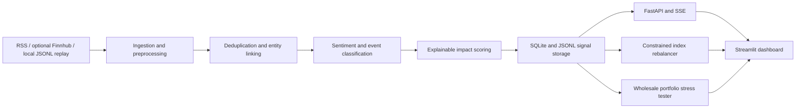

**Build the Unified AI Risk Engine - S&P Global & Crisil Campus Hackathon**

Candidate Name: DIYA GARG 
College Email ID: diya.23bce10125@vitbhopal.ac.in
College: Vellore Institute Of Technology  
Demo Video Link: 

## 1. Project Overview / Problem Statement & Approach

Financial risk teams must sift through large volumes of news and other text to identify which companies or markets may be affected, what kind of event occurred, and whether it may warrant attention. This prototype automates that first layer of triage by turning incoming text into structured, explainable financial risk signals.

The pipeline ingests news feeds or a deterministic offline replay, cleans and deduplicates documents, links mentions to configured companies, classifies sentiment and event type, and calculates an impact score with a component-level explanation. Signals feed two downstream modules: a constrained sentiment-driven rebalancer for a 15-stock universe and an event-driven stress tester for a synthetic wholesale-banking portfolio. A Streamlit dashboard brings the signal feed, portfolio outputs, evaluation metrics, and breaking-news simulation together.

The project is designed for a reproducible hackathon demonstration. Replay mode is the default, and live sources are optional with fallback behavior. The prototype supports decision support and risk exploration; it does not make or execute investment decisions.

## 2. Architecture & Tech Stack

## Architecture

```text
News/social/replay → preprocess + entity linking → local NLP + explainable impact
       ↓                         ↓                         ↓
  SQLite/JSONL                FastAPI/SSE          Rebalancer + stress test
       └────────────────────────── Streamlit dashboard ──────────────────────────┘



- **Application:** Python, FastAPI, Streamlit
- **Data and models:** Pydantic schemas, SQLite, JSONL, YAML configuration
- **Analysis and visualization:** deterministic financial lexicon sentiment, explainable rule-based event classification and scoring, Plotly
- **Packaging:** Make, Docker, Docker Compose
- **Data flow:** text sources → normalized documents → company/event signals → API and persistence → rebalancing and stress outputs → dashboard

## 3. Dataset Used

- The bundled crisis replay contains 70 explicitly labeled synthetic documents. It covers company news, earnings, product launches, mergers, regulation, cybersecurity, credit, macroeconomic and geopolitical events, duplicate stories, delayed social posts, a non-English item, and irrelevant text. Synthetic records are marked `is_synthetic=true`.
- A 50-record hand-labeled synthetic seed set is used for the initial evaluation. Reported seed-set results are 86.0% sentiment accuracy (85.4% macro F1) and 94.0% event accuracy (93.5% macro F1). These are prototype results on synthetic data, not public benchmark claims.
- The rebalancer uses seeded synthetic daily returns for its offline backtest. The stress tester uses a seeded synthetic portfolio of 150 positions and approximately USD 1 billion notional: 45% corporate loans, 25% bonds, 15% derivatives, and 15% equities/FX.
- RSS news and optional Finnhub company news can be configured for live mode. Availability, quotas, and licensing depend on the provider and should be checked before a public demonstration. Live-source failures fall back to replay.
- Assumptions include simplified, transparent asset valuation approximations and a fixed configured universe of 15 tickers: AAPL, MSFT, AMZN, GOOGL, META, NVDA, TSLA, JPM, BAC, GS, XOM, CVX, JNJ, PFE, and WMT. Check index membership before submission.

## 4. Quickstart & Installation

**Runtime:** Python 3.11 recommended; tested on [OS tested]. Docker is also supported.

Clone the repository and run the demo:

```bash
git clone <your-repo-url>
cd <repo-folder>
make setup
make test
make demo
```

The demo command builds the local artifacts and launches the Streamlit dashboard. Replay mode is the recommended offline demo path.

Useful commands:

```bash
make ingest-demo                 # Build/run the ingestion replay
make analyze-demo                # Generate risk signals
make evaluate                    # Generate evaluation reports
make rebalance-demo              # Run the index rebalancer
make stress-demo                 # Run stress tests for high-impact signals
make simulate-breaking-news      # Run the end-to-end breaking-news scenario
make demo                        # Build artifacts and launch the dashboard
docker compose up --build         # Run with Docker Compose
```

To start only the API:

```bash
python -m uvicorn src.api.app:app --reload
```

To start only the dashboard after generating artifacts:

```bash
python -m streamlit run src/dashboard/app.py
```

Optional credentials belong in a local `.env` file based on `.env.example`. No API key is required for the offline replay demo. Review `config/` to change the source settings, company universe, NLP thresholds, portfolio assumptions, and stress scenarios.

## Demo materials
[Five-minute demo script](docs/demo_script.md)
- [Seven-slide presentation content](docs/presentation.md)
- [Judge Q&A](docs/judge_qa.md)

## 5. Key Results & Domain Impact

- Converts unstructured news text into structured signals with sentiment score, event classification, impact score, confidence, and an explanation of the scoring factors.
- Exposes signals through FastAPI endpoints for health, signal queries, high-impact events, and a server-sent event stream.
- Produces constrained target weights for a 15-stock universe and compares a sentiment-weighted strategy with an equal-weight baseline using seeded offline returns.
- Stress-tests a synthetic USD ~1B wholesale portfolio using asset-class-specific approximations. A high-impact breaking-news scenario can automatically trigger a stress run; the scripted Hormuz example produced an approximately **-$39.3M** simulated P&L in the recorded run.
- Provides an interactive dashboard for the signal feed, rebalancer, stress history, model evaluation, and demo narrative.

This workflow can help analysts prioritize potentially material information and inspect possible portfolio sensitivities sooner. All portfolio positions, replay news, backtest returns, and initial evaluation labels are synthetic; results are illustrative and should not be treated as forecasts or investment advice.
